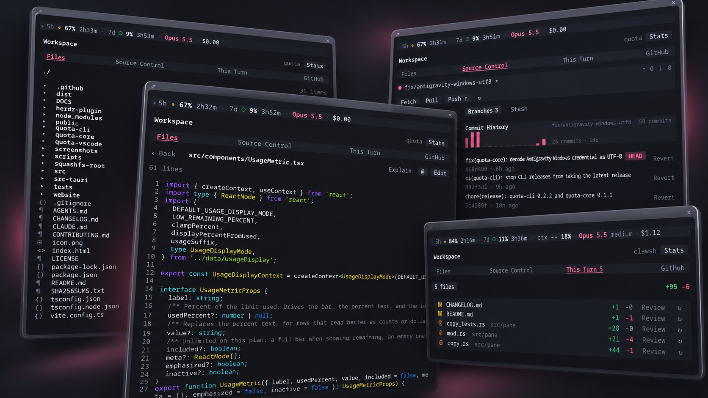
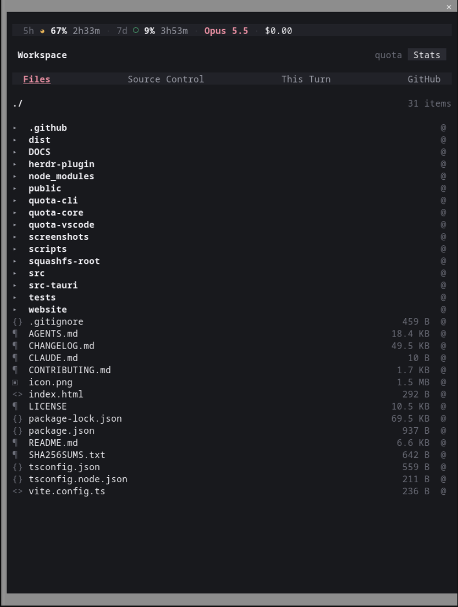
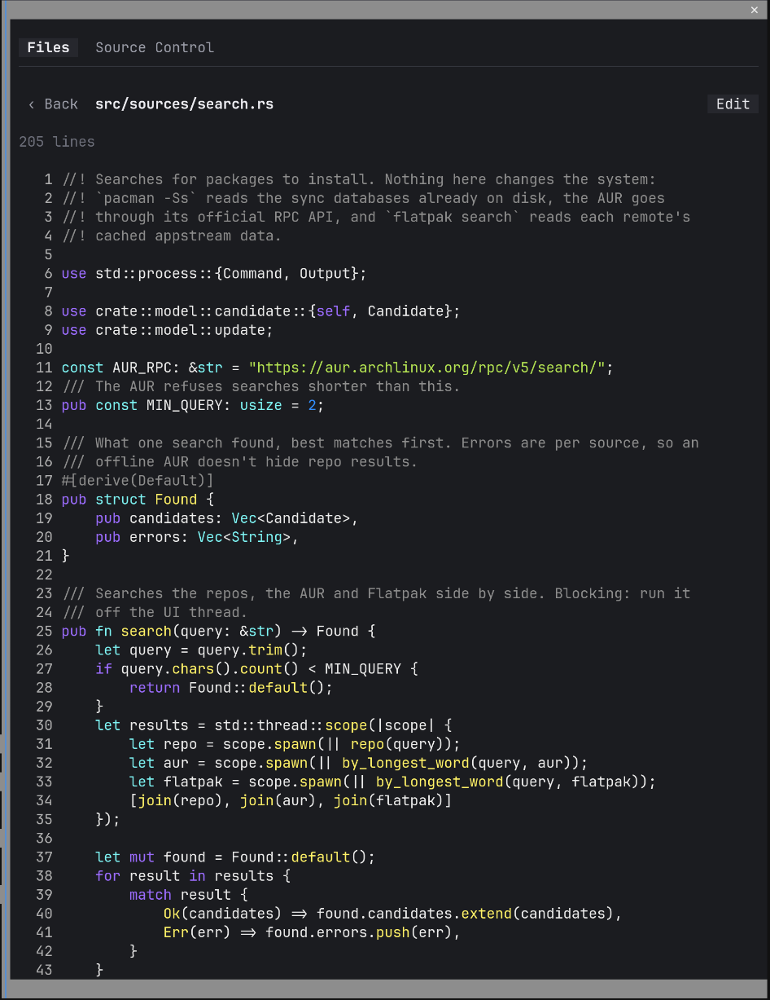
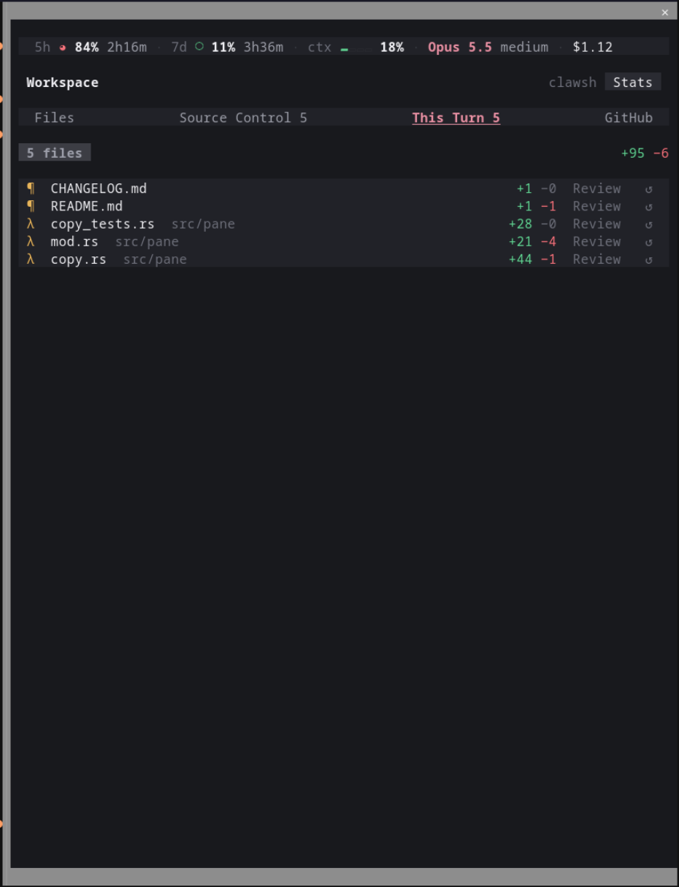
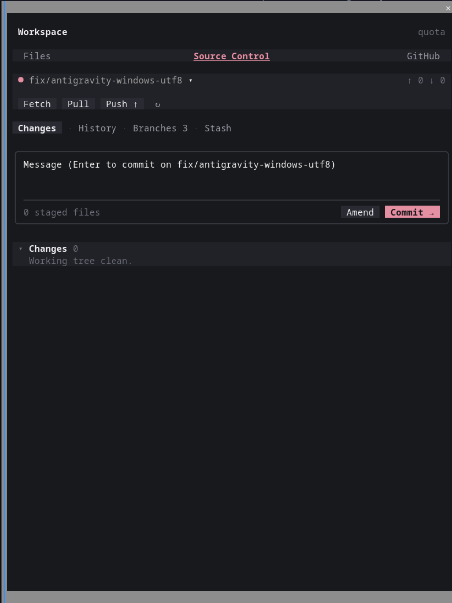
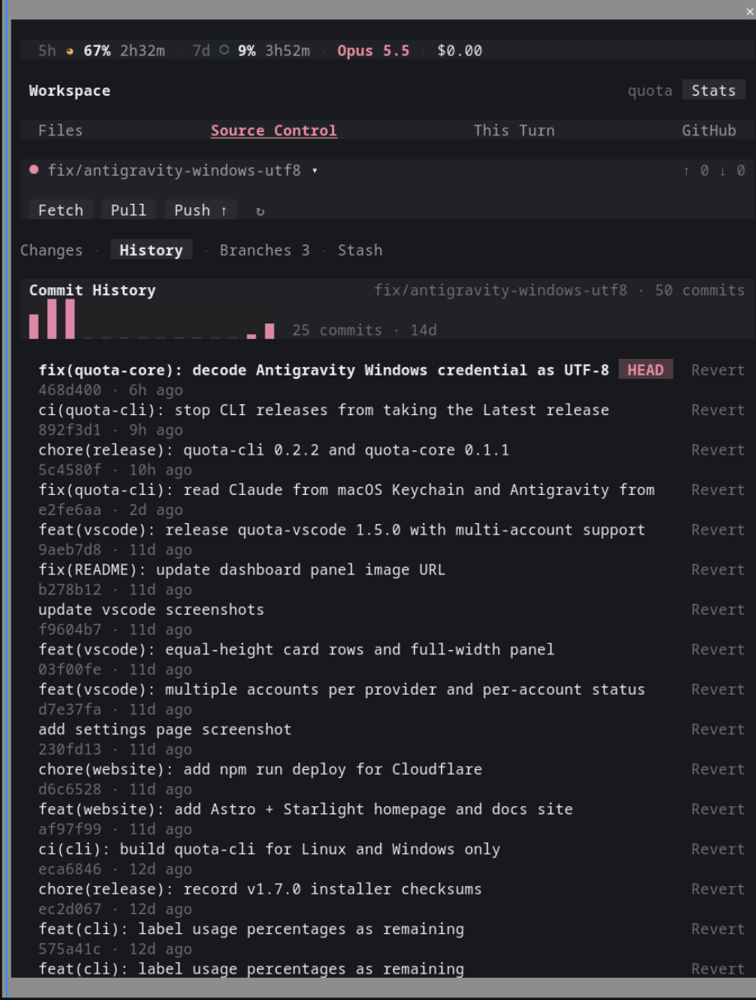
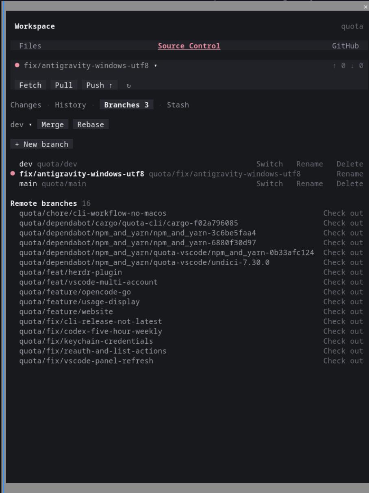
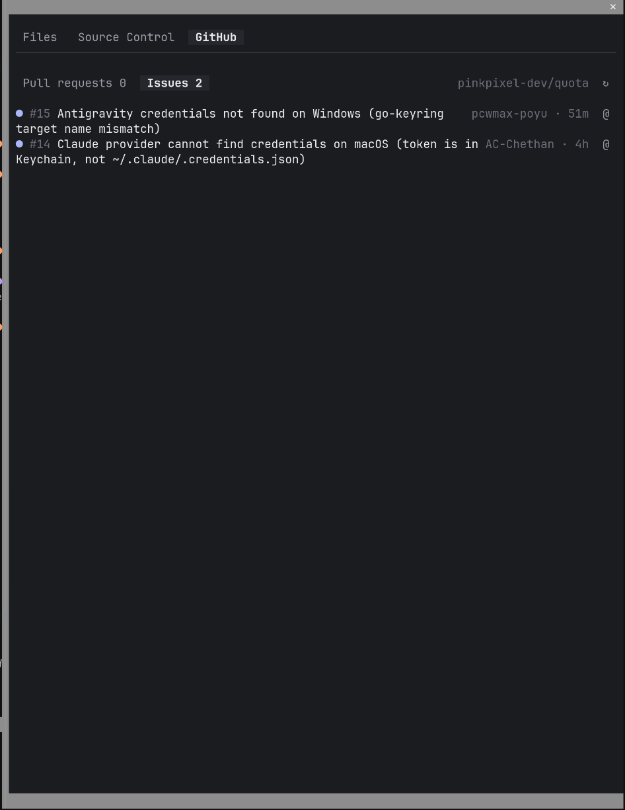

# Workspace

<p align="center">
  
</p>

Workspace is a Claude Code mod that adds a pane for keeping up with what's happening in your project while Claude works. It marks the files Claude reads and edits, shows exactly what Claude changed this turn (with a diff and a way to undo it), keeps your usage limits in view, and can hand work back to Claude with a click. It also does most of your everyday git, plus a read-only look at your GitHub pull requests and issues, so you rarely need to leave Claude Code.

What's in the pane:

- **Files**: browse, read and edit files, with git status and marks for what Claude touched
- **Source Control**: VS Code style git, from staging single hunks to merges, rebases and conflicts
- **This Turn**: every file Claude edited since your last prompt, with diffs, Review and revert
- **GitHub**: open pull requests and issues, with CI and review status
- **Stats strip**: 5 hour and 7 day usage, context, model and cost along the top

<div align="center">

<table>
  <tr>
    <td align="center"><b>Files</b><br></td>
    <td align="center"><b>Viewing a file</b><br></td>
    <td align="center"><b>This Turn</b><br></td>
    <td align="center"><b>Source Control</b><br></td>
  </tr>
</table>
<table>
  <tr>
    <td align="center"><b>History</b><br></td>
    <td align="center"><b>Branches</b><br></td>
    <td align="center"><b>GitHub</b><br></td>
  </tr>
</table>

</div>

## Features

**Files tab**

- Browse the session's working directory, with folders listed first and file sizes on the right. Each file gets a small glyph for its kind, and the path at the top is clickable crumbs so you can jump back up
- Git status right in the list: changed files get their letter (M, A, D, U, R, or `!` for a conflict) in the same colors Source Control uses, and a folder gets a `●` when something inside it changed
- See what Claude is looking at. A file gets `◆` when Claude reads it and `✎` when Claude edits it, and the row lights up while the tool is running. A timeline card at the top lists everything Claude touched this turn, even in folders you aren't looking at, and you can click a name to open it. The marks stay until you send your next prompt
- `@` on any file or folder (and in the file viewer's header) drops `@path` into your prompt box at the cursor, so you can point Claude at it without typing the path
- Open a file to read it with syntax highlighting and line numbers
- Click **Edit** to change it in place, then **Save** (or press Enter) to write it back to disk
- The open file reloads after each Claude turn, so you see edits Claude made
- If the file changed on disk while you were editing it (say Claude edited it mid-turn), **Save** asks before writing over it instead of quietly wiping out that change
- **Explain** in the viewer's header puts `Explain @path` in your prompt box, so asking Claude about a file is one click

**This Turn tab**

- Every file Claude edited since your last prompt, with how many lines it added and removed. Files Claude created get a **new** badge
- That includes files changed by Claude's Bash commands, like a `sed -i` or a script that writes files, not just its Edit and Write tools
- Click a file to see its diff against how it looked before Claude's first edit this turn. That's a different view from Source Control's diff, which compares against your last commit
- `↺` (or **↺ Revert** in the diff) puts the file back the way it was before this turn. For a file Claude created, it deletes the file. Both ask first
- **Review** puts `Review the changes you made to @path` in your prompt box
- The tab label counts the edited files, like **This Turn 2**

**Stats bar**

- A slim strip at the top of the pane with your 5 hour and 7 day usage (with reset times), how full the context window is, the model and effort, and what the session has cost so far. It's the same numbers the status line reads
- When the pane gets narrow, pieces drop off from the right: cost first, then the model, then context
- **Stats** in the title row hides it or brings it back. It starts on, and the pane remembers your choice across sessions

**Source Control tab**

- Staged and unstaged changes, colored the way VS Code does it (added, modified, deleted, renamed). Click the `▾` next to a section to fold it shut when the list gets long
- Click a file to see its diff, and use `+` and `−` to stage or unstage it. The file lights up for a moment in its new section. Inside the diff, each hunk has a header with its line range and counts, plus its own **+ Stage** or **− Unstage** button. **Review** in the diff header asks Claude to look over that file's changes
- A summary row counts your changed files by kind, with a bar showing how they split
- **Stage all** for everything at once
- `↺` on a file throws away its changes, and **Discard all** does the whole list. Both ask first
- A commit message box with a **Commit** button (Enter commits too)
- **✦ Message** writes a commit message for you from the staged diff. It shows up once something is staged, and you can edit the message before committing
- **Amend** to fold staged changes into your last commit, and **Commit all** to stage everything and commit in one go
- **Fetch**, **Pull**, **Push** and a refresh button, plus ahead/behind counts for your branch. Whichever of Pull or Push you need right now is the highlighted one
- A quiet fetch every 3 minutes while the pane is showing, so the ahead/behind counts stay current
- A branch picker that switches branches for you
- A **Branches** view listing your local branches with what each one tracks, plus **+ New branch**, **Rename** and **Delete**. Branches that only exist on a remote show up underneath with a **Check out** button
- A **History** view with the last 50 commits on your branch (**Load more** for older ones) and a branch graph beside them. Click one to see its diff, or **Revert** it. A little bar chart at the top shows commits per day for the last two weeks
- **Stash** in the Changes view sets your work aside, and the **Stash** view has **Apply**, **Pop** and **Drop** for each entry
- **Merge** and **Rebase** at the top of the Branches view, with any local or remote branch as the source
- When a merge, rebase, revert or cherry-pick stops on conflicts, a banner shows up with **Continue** and **Abort**, and the conflicted files get their own **Merge Changes** section with **Ours**, **Theirs** and **Resolved**. This works for ones you started from a terminal too
- A remote picker when the repo has more than one remote. Push, Pull and Fetch use it, and the pane remembers your pick for that repo
- A confirm step before committing or pushing straight to `main` or `master`
- An **Initialize Repository** button when the folder isn't a git repo yet (it runs `git init -b main`)

**GitHub tab**

- Open pull requests and issues for the repo, up to 50 of each, with who last touched them and how long ago. Drafts get a dimmer dot
- Pull requests show their CI result (`✓`, `✗`, `●` pending) and review status (`✓` approved, `±` changes requested, `○` review required), and a card above the list adds those up across all open PRs
- Click one to read it right in the pane: its state, author, branches, review status, a quick count of passing and failing checks, labels, the description and the comments
- `@` on any row (and in the detail header) drops a short reference like `PR #42 "Fix the thing" (https://github.com/...)` into your prompt box at the cursor. Claude can then pull the full thread or diff with `gh` itself, so your prompt doesn't fill up with a whole conversation
- **Open** in the detail view takes you to it on GitHub, and `↻` reloads the lists
- The lists refresh after each Claude turn while the tab is showing, so a PR Claude just opened shows up on its own

The pane draws its own dark theme, so it looks the same no matter which Claude Code theme you use.

### The History graph

In kitty and Ghostty the graph is drawn as a real picture, with smooth curves where branches split and merge. Everywhere else you get the same graph in Unicode box characters. The pane guesses which one to use from your terminal's environment (`TERM`, `TERM_PROGRAM` and `KITTY_WINDOW_ID`). If it guesses wrong, set `CLAUDE_WORKSPACE_GRAPH` before starting Claude Code:

```bash
CLAUDE_WORKSPACE_GRAPH=text claude    # always use the Unicode graph
CLAUDE_WORKSPACE_GRAPH=image claude   # always draw the picture
```

## Installation

You need Claude Code in a terminal. Installing goes through this repo, which doubles as a plugin marketplace.

At the Claude Code prompt:

```text
/plugin install workspace --marketplace pinkpixel-dev/claude-workspace
```

Answer `y` when it asks to add the `github:pinkpixel-dev/claude-workspace` marketplace, then pick a scope (the user scope is first, press Enter for it). The mod is active right away.

From a regular shell instead:

```bash
claude plugin install workspace --marketplace pinkpixel-dev/claude-workspace
```

If you'd rather add the marketplace first and install the plugin as a separate step:

```text
/plugin marketplace add pinkpixel-dev/claude-workspace
/plugin install workspace@claude-workspace
```

In the Claude Code desktop app, where `/plugin` doesn't run: click **+** next to the prompt box, then **Plugins**, **Add marketplace** with `pinkpixel-dev/claude-workspace`, then **Add plugin**.

To update to the latest version later, run this from a shell and then restart Claude Code:

```bash
claude plugin update workspace@claude-workspace
```

## Usage

Open the pane with:

```text
/workspace
```

Click the tabs at the top, or focus the pane and use Tab, the arrow keys and Enter. Esc takes you back to the prompt.

A few things worth knowing:

- In the editor, Enter saves. You get a new line the same way you do in the Claude Code prompt box.
- Commit only commits what's staged. If nothing is staged, the pane tells you instead of guessing. Use **Commit all** if you want everything in.
- Discarding an untracked file deletes it. It was never in git, so there's no getting it back.
- Amend with an empty message box keeps the old commit message. Type one to replace it. If the commit is already pushed, the pane warns you first, since pushing it again needs a force push (which the pane doesn't do).
- If your branch has no upstream yet, Push runs `git push -u <remote> <branch>` for you.
- Pull runs `git pull --no-edit`, so a merge never stops to open an editor. If you picked a remote other than the one your branch tracks, Push and Pull name that remote and branch directly.
- New branches start from wherever you are, and the pane switches you onto them.
- **Check out** on a remote branch runs `git switch --track <remote>/<name>`, which makes a local copy that tracks it.
- **Revert** makes a new commit that undoes the old one, so it never rewrites history. If it conflicts with later changes, it stops in Merge Changes like a merge does. Merge commits don't get a Revert button.
- Stash includes untracked files. If you've typed something in the commit message box, that becomes the stash's name. **Drop** asks first, since a dropped stash is basically gone.
- If applying or popping a stash conflicts, git keeps the stash and the conflicted files show up in Merge Changes.
- Merging into `main` or `master` asks first. Rebase always asks, since it rewrites your branch's commits (and if the branch is already pushed, you'll need a force push after).
- Click a conflicted file to open it in the Files tab and fix it by hand, then hit **Resolved**. If the file still has conflict markers in it, the pane asks before staging it.
- **Ours** and **Theirs** keep one side's whole file. Heads up: during a rebase git flips these, so **Ours** is the branch you're rebasing onto and **Theirs** is your own commit.
- **Continue** finishes the merge (or moves the rebase to its next commit) using git's own commit message, since there's no editor to open. It won't run while conflicts are left.
- **Abort** asks first, then puts everything back to how it was before the merge or rebase started.
- **✦ Message** sends the staged diff and your last 10 commit subjects to Haiku, which costs a tiny bit of usage. The message follows Conventional Commits and ends with a `Co-Authored-By: Claude <model> <noreply@anthropic.com>` line naming the session's model. Delete that line if you don't want it.
- **Review** and **Explain** only fill the prompt box. Nothing gets sent until you press Enter, so you can add to the request first.
- This Turn starts fresh every time you send a prompt (slash commands don't count). Once you send the next prompt, the old before-edit copies are gone, so revert what you want to revert first.
- Reverting a file Claude created runs `git clean -f -x -q -- <path>`, since Claude Code's file API can't delete files. That means it only works inside a git repository.
- The GitHub tab is read-only for now. It doesn't comment, review, merge or close anything. If you want one of those, `@` the item and ask Claude.
- Delete tries the safe `git branch -d` first. If the branch has commits that aren't merged anywhere, git refuses, and the pane offers a **Force delete** (`-D`) behind a confirm. You can't delete the branch you're on.

## Limitations

- **The GitHub tab needs the GitHub CLI.** It runs `gh` in your repo, so you need [gh](https://cli.github.com) installed and logged in (`gh auth login`), and the repo's remote has to be on GitHub. If any of that is missing, the tab shows gh's error instead of a list.
- **Git hooks don't run.** Claude Code runs git for mods with repo hooks turned off, so things like husky or pre-commit checks get skipped for commits made from the pane.
- **Push and pull won't ask for a password.** They need an SSH key or a git credential helper already set up. Without one they fail fast and show git's error instead of hanging.
- **Rebase is plain only.** There's no interactive rebase (squash, reorder, edit), since that needs an editor the pane can't drive.
- **Staging goes down to hunks, not lines.** You can't stage a single line, and untracked files only stage as a whole.
- **The editor is a plain text box.** It's good for quick edits, but there's no highlighting while you type, no multi-cursor and no real undo history.
- **Big and binary files are view only.** Files over 1 MB don't open, binary files show a note, and very long files show the start and can't be edited.
- **This Turn only remembers one turn.** The before-edit copies are kept in memory, so they're gone once you send your next prompt or restart Claude Code. Notebook edits show up in the list but have no copy to diff or revert, and neither do files too large for the Edit tool to hand back, or Bash changes Claude Code didn't make a diff for (it skips some, like big batches of files).
- **Bash tracking leans on an internal field.** Files changed by Bash come from the per-file diff Claude Code attaches to Bash results, which its own types mark as internal. If a future Claude Code release changes it, Bash edits would quietly stop showing up in This Turn and the `✎` marks, while Edit and Write keep working.
- **The background fetch is silent.** If it fails (no network, a key that needs a passphrase), it just skips that round. Hit **Fetch** to see the actual error.
- **Mobile isn't supported.** The pane needs text inputs, which the mobile app doesn't have.
- The pane opens at any width when you run `/workspace`, but it's way nicer with a wide terminal.
- **The History graph only follows your current branch.** It reads the same `git log` as the list, so it shows merges into your branch but not other branches' tips.
- **The picture graph needs kitty-style image support.** I haven't tried it inside tmux, so it might not draw there even in kitty. Use `CLAUDE_WORKSPACE_GRAPH=text` if you see a blank column.

The Claude Code mod API is still early access. I built this on Claude Code 2.1.303, so a future release could change something the mod relies on.

## How it works

It's a single hooks module. `/workspace` opens a pane, and the pane is drawn from state the mod keeps for the session. Buttons call git through Claude Code's process API (no shell involved) and read or write files through its file API. After each Claude turn, the mod refreshes the file list and git status so the pane stays in sync with whatever Claude just did. It also watches Claude's file tool calls as they happen, which is where the read and edit marks come from. Claude's Edit and Write results include the file as it was before the call, and Bash results include a diff of every file the command changed, which the mod undoes on the current file to get the old text back. Either way, it keeps the first copy per file each turn. That copy is what This Turn diffs against and reverts to.

```text
hooks/
  register.tsx        /workspace command, refresh after each turn, the pane frame and tabs
  files-view.tsx      file browser, viewer and editor
  git-view.tsx        branch and remote pickers, sub-tabs, the Changes view
  diff-view.tsx       a file's diff, split into hunks
  turn-view.tsx       the This Turn tab
  stats-view.tsx      the stats strip: its usage figures, toggle and row
  confirm-view.tsx    the confirm card, busy label and notice every tab shares
  merge-view.tsx      the operation banner, Merge Changes and the Merge/Rebase row
  branches-view.tsx   the Branches view
  history-view.tsx    the History view, its graph and the activity chart
  stash-view.tsx      the Stash view
  actions.ts          what the Files tab's buttons do: file reads and writes, and @ mentions
  activity.ts         watches Claude's file tools for the read and edit marks
  turn-actions.ts     before-edit copies, This Turn diffs and reverts, Review/Explain, and ✦ Message
  tree.ts             maps git and tool paths onto the file list (no Claude Code calls)
  git-actions.ts      what the Source Control buttons do, plus the background fetch
  branch-actions.ts   new, rename, delete and check out remote branches
  history-actions.ts  history, revert and stash
  merge-actions.ts    merge, rebase, Continue/Abort and resolving conflicts
  repo.ts             shared git plumbing: running git, errors, reading repo status
  git.ts              parses git output (no Claude Code calls, so it's easy to test)
  graph.ts            lays out the History graph and its Unicode cells (no Claude Code calls)
  graph-image.ts      draws the graph as RGBA pixels for kitty and Ghostty
  chart.ts            the commit-activity chart's data and Raster cells
  diff.ts             a line diff for This Turn (no Claude Code calls)
  stats.ts            the stats strip's text and what fits a width (no Claude Code calls)
  icons.ts            file-kind glyphs
  base64.ts           base64 for Raster cells and Image bytes
  controls.tsx        shared chips, tabs, section headers, frames, cards, badges, bars and divider
  theme.ts            color tokens
  *.test.ts(x)        tests
types/index.d.ts      the shape of the session state
```

## Development

Clone the repo and start Claude Code with the folder loaded:

```bash
git clone https://github.com/pinkpixel-dev/claude-workspace.git
claude --plugin-dir ./claude-workspace
```

Edits to the folder reload while that session runs. To check your changes:

```bash
claude plugin validate ./claude-workspace
claude plugin test ./claude-workspace
```

The tests run against Claude Code's own test kit. The git tests feed real `git status` output through the parser, and the pane tests draw the pane and press its buttons against a fake repo, so they don't touch your actual git setup.

## License

Apache 2.0. See [LICENSE](LICENSE).

---

Made with 💖 by [Pink Pixel](https://pinkpixel.dev)
